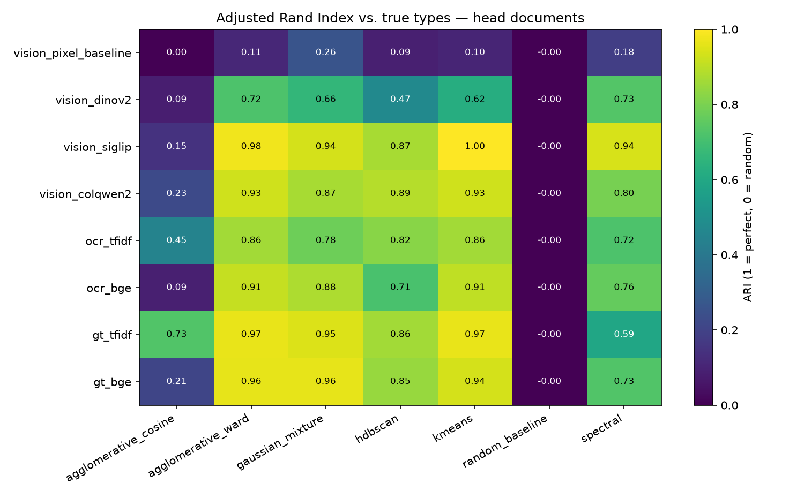

# Embedding Comparison: Vision vs. OCR Text

**Tasks:** #5 (cluster with 3+ methods on OCR vs. vision channels) and the out-of-scope metrics task (precision, recall, ROC-AUC). Feeds issue #6 (metric determination).
**Code:** [`analysis/clustering.py`](../analysis/clustering.py), [`analysis/out_of_scope.py`](../analysis/out_of_scope.py). **Results:** [`results/`](../results/).

```bash
python -m features.vision_embeddings   # 4 vision channels (ColQwen2 takes ~25 min on an M4 laptop)
python -m features.ocr                 # see docs/ocr_channel.md
python -m features.text_embeddings
python -m analysis.clustering          # results/clustering_comparison.csv + figures
python -m analysis.out_of_scope        # results/out_of_scope_*.csv
```

## Channels compared

| Channel | Family | What it is |
|---|---|---|
| `vision_pixel_baseline` | vision | 32×32 grayscale thumbnail. No model; sets the floor |
| `vision_dinov2` | vision | `facebook/dinov2-large`, CLS token |
| `vision_siglip` | vision | `google/siglip-so400m-patch14-384`, pooled embedding (the vision tower of ColPali) |
| `vision_colqwen2` | vision | `vidore/colqwen2-v1.0-hf`, mean of patch vectors (a document-retrieval model that reads text in the image) |
| `ocr_tfidf`, `ocr_bge` | OCR text | Tesseract text, then TF-IDF/SVD or `BAAI/bge-base-en-v1.5` |
| `gt_tfidf`, `gt_bge` | clean text | The same encoders on the ground-truth transcription. An upper bound, not available in production |

The vision loaders are Chinmaya's from the `data/preprocessing` branch (issue #2), moved into `features/vision_embeddings.py` so every channel is scored by the same scripts.

## 1. Clustering: SigLIP separates all 18 types best

Adjusted Rand Index (ARI) against the true type, all 925 head-class documents (18 types). 1 = perfect, 0 = random. NMI tells the same story (`results/clustering_comparison.csv`).

| Channel | k-means | Ward | GMM | Spectral | HDBSCAN | Avg-link cosine |
|---|---|---|---|---|---|---|
| Pixel baseline | 0.10 | 0.11 | 0.26 | 0.18 | 0.09 | 0.00 |
| DINOv2 | 0.62 | 0.72 | 0.66 | 0.73 | 0.47 | 0.09 |
| **SigLIP** | **1.00** | **0.98** | 0.94 | **0.94** | 0.87 | 0.15 |
| ColQwen2 | 0.93 | 0.93 | 0.87 | 0.80 | **0.89** | 0.23 |
| OCR + TF-IDF | 0.86 | 0.86 | 0.78 | 0.72 | 0.82 | 0.45 |
| OCR + bge | 0.91 | 0.91 | 0.88 | 0.76 | 0.71 | 0.09 |
| Clean text + TF-IDF | 0.97 | 0.97 | 0.95 | 0.59 | 0.86 | 0.73 |
| Clean text + bge | 0.94 | 0.96 | 0.96 | 0.73 | 0.85 | 0.21 |

Random baseline (20 seeds): ARI 0.00 everywhere.



**On the 5 legal types only** (264 documents), every learned channel reaches ARI 0.98–1.00 with k-means, and the pixel baseline gets 0.33. The legal types in this benchmark each follow one template, so they're too easy to rank channels on. That's why the 18-type result is the one to use for the vision-vs-text decision. See `results/figures/clustering_ari_legal.png` and `results/figures/tsne_legal.png`.

**What this means:**
- **Vision beats OCR text when the vision model is right.** SigLIP + k-means scores 1.00 and ColQwen2 0.93, vs. 0.91 for OCR + bge. DINOv2, a vision model trained without text, scores only 0.62, below both text channels.
- **Most of the text channel's gap is OCR error.** The same encoders on clean text reach 0.94–0.97. Better OCR would narrow the gap.
- **The algorithm matters about as much as the channel.** k-means and Ward are the best or near-best on every channel. Average-linkage cosine fails on almost everything: OCR + bge scores 0.09 with it and 0.91 with Ward. Always compare channels with the same algorithm.
- **Embedding quality without any algorithm** (silhouette of the true labels, cosine, 18 types): **ColQwen2 0.62**, clean TF-IDF 0.59, SigLIP 0.54, OCR TF-IDF 0.53, clean bge 0.52, OCR bge 0.41, DINOv2 0.38, pixel −0.02. ColQwen2 puts same-type documents closest together, even though k-means recovers SigLIP's groups more exactly. On the 5 legal types its silhouette is 0.82, the highest of any channel.

## 2. Out-of-scope detection: easy on this data, but vision partly learned "photo"

Detector: a document's score is 1 minus its mean cosine similarity to its 5 nearest **in-scope training** documents. The threshold is chosen on val to maximize F1. It is scored on the test split, with each negative set reported separately, as the scope policy requires. Positive = out of scope (should be flagged).

| Channel | ROC-AUC, held-out types | ROC-AUC, rare (tail) types | Precision (all) | Recall (all) | Legal photos flagged (of 4) |
|---|---|---|---|---|---|
| Pixel baseline | 0.79 | 0.87 | 0.93 | 0.97 | 4 |
| DINOv2 | 1.00 | 1.00 | 1.00 | 1.00 | **4** |
| SigLIP | 1.00 | 1.00 | 0.97 | 1.00 | **2** |
| ColQwen2 | 1.00 | 1.00 | 1.00 | 0.97 | **0** |
| OCR + TF-IDF | 1.00 | 0.99 | 1.00 | 0.97 | 1 |
| OCR + bge | 1.00 | 1.00 | 1.00 | 0.99 | **0** |
| Clean text + bge | 1.00 | 1.00 | 1.00 | 1.00 | 0 |

The **legal-adjacent** types (account statements, credit cards, Form 1040) are flagged with ROC-AUC 1.00 by every learned channel. The pixel baseline only reaches 0.77 on them.

**The photo check matters.** All 4 in-scope PHOTO documents (ids 32, 65, 135, 760) are in train, so they're scored leave-self-out. DINOv2 flags all 4 as out of scope, and SigLIP flags 2. Those two vision detectors partly learned "this is a photo" rather than "this is not a legal type," which is the confound the scope policy predicted, since all 75 tail documents are photos. The OCR + bge detector flags none of them, and neither does ColQwen2, the vision model trained to read document text. With only 4 examples this is a warning sign, not a measurement, but a real intake queue will receive phone photos of leases.

## Recommendation for issue #6

- **For classification and clustering, use SigLIP.** It has the highest ARI and NMI on 18 types, and it's fast (~4 min for 1,000 pages on a laptop).
- **For out-of-scope detection, use ColQwen2 or OCR + bge.** Every learned channel separates the types, but only these two ignore capture style. ColQwen2 does it without an OCR step, at about 25 minutes per 1,000 pages on a laptop GPU vs. about 4 for SigLIP.
- **Worth testing in October:** SigLIP for the classifier and ColQwen2 for the detector, compared against a single-channel setup.
- **Don't rank channels on the 5 legal types alone.** All of them saturate there.

## Caveats

- One seed (42) and one split. Differences of a few hundredths of ARI are within noise.
- The out-of-scope test split has 39 in-scope and 175 out-of-scope documents. Precision and recall move by about 0.03 per document.
- All channels use frozen embeddings with no fine-tuning. The detector is deliberately simple. October's dedicated detector should beat it.
